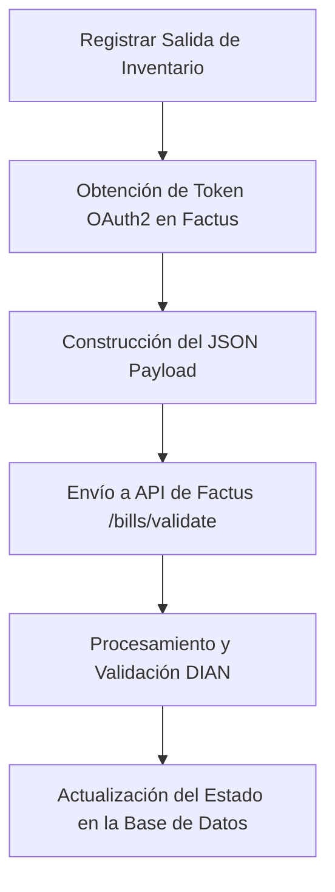

# Guía de Facturación Electrónica con la API de Factus

Este documento explica de forma detallada y paso a paso cómo funciona el flujo de facturación electrónica en tu sistema de inventario utilizando la API de **Factus** y el framework Laravel.

---

## 📌 1. Flujo General del Proceso

El proceso de facturación electrónica se compone de 4 fases principales:



1. **Registro:** El usuario crea un movimiento de **Salida** en el sistema e indica que desea facturar electrónicamente.
2. **Autenticación:** El sistema solicita un token de acceso seguro de forma automática a Factus.
3. **Mapeo de Datos:** Se recolectan los datos del cliente, de la venta y de los productos para armar el formato requerido.
4. **Envío y Validación:** Los datos se mandan a Factus, que realiza la validación ante la **DIAN** y retorna el resultado (CUFE, PDF público, etc.).
5. **Persistencia:** El sistema actualiza la base de datos local con la información oficial emitida.

---

## 🔐 2. Autenticación (OAuth2)

Antes de enviar cualquier factura, el sistema debe autenticarse. Esto se realiza en el método `obtenerToken()` de `FactusService`:

* **Endpoint de Factus:** `POST {BASE_URL}/oauth/token`
* **Datos enviados (Form URL Encoded):**
  * `grant_type`: `"password"`
  * `client_id`: ID de tu cliente asignado por Factus.
  * `client_secret`: Secreto de cliente.
  * `username`: Tu correo registrado en Factus.
  * `password`: Tu contraseña de Factus.
* **Optimización de rendimiento:** Para evitar saturar la API y acelerar el proceso, el Token obtenido se guarda en la **Caché de Laravel** durante **3600 segundos (1 hora)**. Así, las siguientes facturas en esa hora se procesan al instante sin volver a loguearse.

---

## 🗄️ 3. Origen de los Datos (¿De dónde se saca la info?)

La información se extrae directamente de tres modelos relacionales en tu base de datos:

### A. Datos Generales de la Venta (Modelo `Salida`)
* **Código de referencia (`reference_code`):** Se usa el número de factura local o el ID autoincremental de la salida.
* **Observación (`observation`):** Notas adicionales escritas en el formulario o `"Venta de productos"` por defecto.
* **Método de pago (`payment_method_code`):** Se mapea por defecto a `"10"` (Efectivo) para Factus.

### B. Datos del Cliente (Modelo `Proveedor` / `Tercero`)
* **Identificación (`identification`):** `nit` o cédula del cliente.
* **Nombre (`names`):** `nombre` comercial o natural del cliente.
* **Dirección (`address`):** `direccion` física del cliente (campo corregido recientemente de `direction` a `direccion`).
* **Correo (`email`):** `email` (obligatorio para la DIAN para el envío del PDF).
* **Teléfono (`phone`):** `telefono`.
* **Tipo de persona (`legal_organization_id`):** 
  * Si el tipo es `'empresa'`, se manda `"1"` (Persona Jurídica).
  * Si el tipo es `'persona'`, se manda `"2"` (Persona Natural).

### C. Productos Facturados (Modelo `SalidaDetalle` y `Producto`)
Para cada fila en la tabla de productos de la venta, se crea un ítem en el JSON:
* **Código de referencia (`code_reference`):** El `codigo` del producto en tu inventario.
* **Nombre (`name`):** El `nombre` del producto.
* **Cantidad (`quantity`):** Cantidad vendida.
* **Precio (`price`):** El precio unitario neto de venta (`precio_unitario`).
* **Tarifa de IVA (`tax_rate`):** `iva_porcentaje` (ej. `19.00`, `0.00`).
* **Es excluido (`is_excluded`):** Si el IVA es `0`, se marca como `1` (Excluido), de lo contrario `0`.

---

## 🚀 4. Envío de Datos (¿A dónde se mandan?)

Una vez armado el JSON, se realiza una petición HTTP POST usando el cliente de Laravel:

* **Endpoint de Validación:** `POST {BASE_URL}/{API_VERSION}/bills/validate`
* **Cabeceras HTTP requeridas:**
  * `Accept: application/json`
  * `Authorization: Bearer {EL_TOKEN_DE_CACHE}`

### Ejemplo simplificado del JSON enviado a Factus:
```json
{
  "numbering_range_id": 8,
  "reference_code": "125",
  "observation": "Venta en tienda física",
  "payment_method_code": "10",
  "customer": {
    "identification": "10203040",
    "names": "Juan Pérez",
    "address": "Calle 45 # 12-30",
    "email": "juan.perez@example.com",
    "phone": "3001234567",
    "legal_organization_id": "2",
    "tribute_id": "21",
    "identification_document_id": "6",
    "municipality_id": "980"
  },
  "items": [
    {
      "code_reference": "PROD-001",
      "name": "Teclado Mecánico",
      "quantity": 1.0,
      "discount": 0,
      "discount_rate": 0,
      "price": 150000.0,
      "tax_rate": "19.00",
      "unit_measure_id": 70,
      "standard_code_id": 1,
      "is_excluded": 0,
      "tribute_id": 1,
      "withholding_taxes": []
    }
  ]
}
```

---

## 📥 5. Recepción y Respuesta de la API (¿Cómo responde?)

Factus recibe este JSON, lo procesa con sus firmas digitales, lo comunica directamente a la **DIAN** y nos devuelve una respuesta estructurada en formato JSON.

### A. Si la factura es aprobada y validada:
La API nos devuelve un estado `is_validated = true` y objetos con el detalle oficial:
* **`id` / `reference_code`:** El identificador oficial dentro de Factus.
* **`number`:** El consecutivo oficial de facturación asignado (ej. `SETP 990000123`).
* **`cufe`:** Código Único de Facturación Electrónica (la firma digital oficial colombiana).
* **`public_url`:** Enlace directo para descargar el formato de factura en PDF oficial de la DIAN.

**Acción del sistema:**
El sistema actualiza el registro local en tu base de datos de la siguiente manera:
```php
$salida->update([
    'factus_id'      => $bill['id'],
    'estado_dian'    => 'validada',
    'numero_factura' => $bill['number'],
    'cufe'           => $bill['cufe'],
    'url_factus'     => $bill['public_url'],
]);
```
Posteriormente, al usuario se le redirige mostrándole un aviso verde y **abriendo automáticamente la factura oficial en PDF en una pestaña nueva** para su entrega o impresión.

### B. Si hay un error (ej. NIT inválido, faltan campos, token expirado):
La respuesta viene con código de error HTTP (como `422` o `400`) y un array de `"errors"`.

**Acción del sistema:**
El sistema atrapa el error y actualiza el estado local a `'error_envio'`. En la pantalla de movimientos verás el estado en rojo y la plataforma te mostrará el mensaje descriptivo del error en pantalla (ej. *"El correo electrónico no es válido"*).

---

## ⚙️ 6. Variables de Configuración (`.env`)

Toda la comunicación segura se gestiona mediante tus variables de entorno en el archivo `.env`:

```env
# Configuración del Servicio Factus API
FACTUS_URL=https://api.factus.com.co           # URL base del API
FACTUS_API_VERSION=v1                          # Versión del API
FACTUS_CLIENT_ID=tu_client_id_aqui             # Credenciales de API
FACTUS_CLIENT_SECRET=tu_client_secret_aqui     # Credenciales de API
FACTUS_USERNAME=tu_usuario_factus              # Usuario de tu cuenta
FACTUS_PASSWORD=tu_contraseña_factus           # Contraseña de tu cuenta
FACTUS_NUMBERING_RANGE_ID=8                    # ID del rango de numeración DIAN habilitado en Factus
```

Estas variables alimentan directamente al archivo `config/services.php` para que `FactusService` las lea dinámicamente y con seguridad sin exponer datos sensibles.
